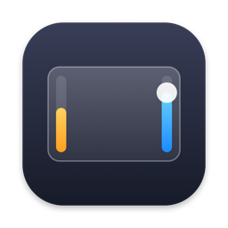
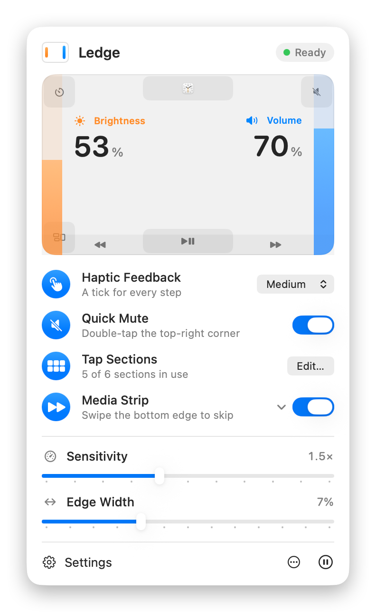
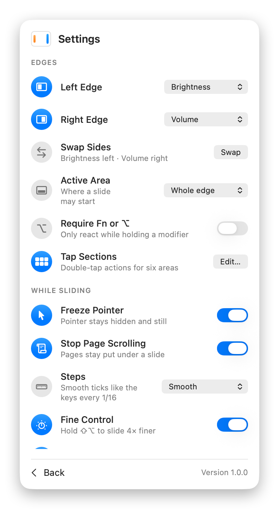
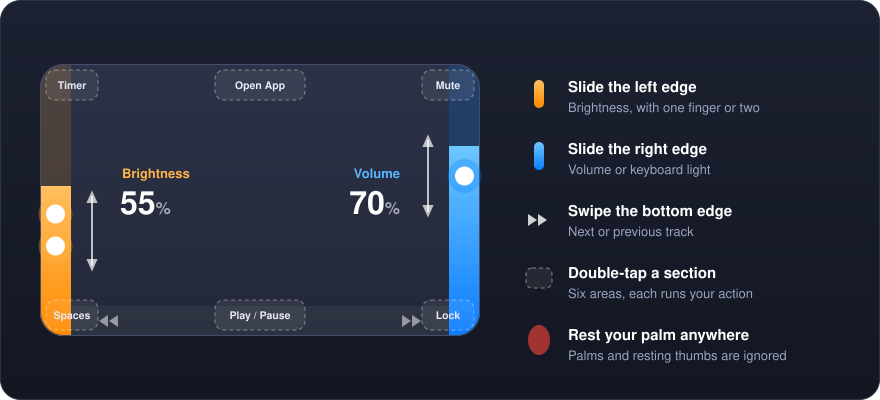
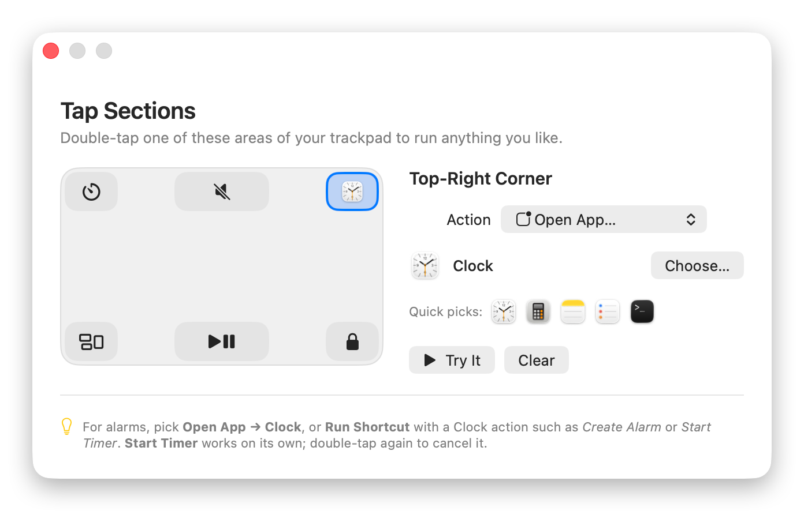

<div align="center">



# Ledge

**Turn the edges of your Mac's trackpad into brightness and volume sliders.**

Slide along an edge to change a level, swipe the bottom to skip a track,<br>
and double-tap a section of the trackpad to run anything you like.

[](#install)
[](Package.swift)
[](LICENSE)
[](#install)

<br>

<picture>
  <source media="(prefers-color-scheme: dark)" srcset="docs/images/menu-dark.png">
  
</picture>
<picture>
  <source media="(prefers-color-scheme: dark)" srcset="docs/images/settings-dark.png">
  
</picture>

</div>

## Why Ledge

Your thumb and fingers are already on the trackpad. Ledge lets them change the screen brightness
or the volume without reaching for the keys, and it feels like a real slider: it follows your finger,
ticks under it with the trackpad's haptics, and leaves the page you're reading exactly where it was.

It is a small native menu bar app. It's free, open source and private: no account, no analytics,
no network code at all.

<p align="center">
  
</p>

## Features

| Feature | What it does |
|---|---|
| **Edge sliders** | Left edge for brightness and right edge for volume by default. Either edge can control brightness, volume, the keyboard backlight or nothing. Slide with one finger or two. |
| **Fast and smooth** | A slide starts after 1 mm of movement and moves in 1% steps, with a haptic tick every sixteenth like the brightness keys. Prefer coarser steps? Pick quarter or keyboard steps. Hold **⇧⌥** to slide 4× finer. |
| **Palm proof** | Ledge reads the size of every contact from the trackpad sensor. Palms are ignored, and a thumb or palm resting on the pad doesn't stop a slide. |
| **Pages stay put** | Scrolling and its momentum are held back while you slide, so the page under the pointer doesn't move. |
| **Haptics** | A tick from the Force Touch trackpad on every step (Light, Medium or Strong), plus a firmer bump at 0%, 100% and when a tap action runs. |
| **Pointer freeze** | The pointer hides and stays still while you slide, then comes back exactly where it was. |
| **Tap sections** | Double-tap any of six areas (four corners, top middle, bottom middle) to open an app, run a Shortcut, start a timer, press keys, open a link or run a command. [More below](#tap-sections). |
| **Media strip** | Swipe along the bottom edge for the next or previous track. The direction can be reversed. |
| **On-screen display** | The system HUD, or a matching native-style one wherever macOS won't draw it (brightness on macOS 26, keyboard light). You can also pick a slim bar at the screen edge, or nothing. |
| **Live trackpad map** | The menu shows the zones, the tap sections, the current levels and every finger on the pad in real time, with palms in red. |
| **Stays out of the way** | Let slides start only in the bottom ¾, ½ or ¼ of an edge, or only while holding Fn or ⌥. Ordinary pointing, scrolling and multi-finger gestures are untouched. |
| **Every trackpad** | Built-in and Magic Trackpad, picked back up after sleep or reconnecting. A Magic Mouse is ignored. |
| **Light** | Menu bar only, no Dock icon, about 0% CPU when idle. |

## Install

**Requirements:** macOS 14 Sonoma or later, a Mac with a trackpad (built-in or Magic Trackpad), and
Xcode or the Command Line Tools (`xcode-select --install`) to build it.

```bash
git clone https://github.com/CTAGRAM/ledge.git
cd ledge
./scripts/build-app.sh --install
open /Applications/Ledge.app
```

`build-app.sh` builds a release version into `build/Ledge.app`. `--install` also copies it to
`/Applications`.

### First launch

Ledge opens a short setup guide and asks for **Accessibility** access (System Settings › Privacy &
Security › Accessibility). It needs this to freeze the pointer, hold back page scrolling, send media
keys and swallow the click that tap-to-click would add to a corner tap. Brightness and volume slides
work without it.

Turn on **Open at Login** in Settings to have Ledge start with your Mac.

## Using Ledge

| Gesture | Where | What happens |
|---|---|---|
| Slide up or down | Left edge | Brightness |
| Slide up or down | Right edge | Volume |
| Hold **⇧⌥** while sliding | Either edge | 4× finer steps |
| Swipe left or right | Bottom edge | Previous or next track |
| Double-tap | Top-right corner | Mute or unmute (Quick Mute) |
| Double-tap | Bottom middle | Play or pause, when turned on under Media Strip |
| Double-tap | Any of the six sections | The action you gave it |

Everything is set from the menu bar icon. The first page has the common switches, and **Settings**
has the rest.

<details>
<summary><b>All settings</b></summary>
<br>

| Setting | Options | Default |
|---|---|---|
| Left Edge / Right Edge | Brightness, Volume, Keyboard Light, Nothing | Brightness / Volume |
| Swap Sides | Swaps the two edges | |
| Active Area | Whole edge, Bottom ¾, Bottom half, Bottom quarter | Whole edge |
| Require Fn or ⌥ | Only react while a modifier is held | Off |
| Haptic Feedback | Off, Light, Medium, Strong | Medium |
| Quick Mute | Double-tap the top-right corner to mute | On |
| Media Strip | Swipe the bottom edge to skip; also Double-tap to Play/Pause and Reverse Swipe | On |
| Sensitivity | How far a slide moves the level | 1.5× |
| Edge Width | How wide each edge zone is | 7% |
| Freeze Pointer | Pointer stays hidden and still while sliding | On |
| Stop Page Scrolling | Pages stay put under a slide | On |
| Steps | Smooth, Quarter Steps, Keyboard Steps | Smooth |
| Fine Control | Hold ⇧⌥ to slide 4× finer | On |
| On-Screen Display | System, Edge Bar, None | System |
| Appearance | Auto, Light, Dark | Auto |
| Open at Login | Start Ledge with your Mac | Off |

</details>

## Tap sections

<p align="center">
  <picture>
    <source media="(prefers-color-scheme: dark)" srcset="docs/images/sections-dark.png">
    
  </picture>
</p>

Open **Tap Sections → Edit…** from the menu, click a section, then choose what a double-tap on it
does:

| Group | Actions |
|---|---|
| Media | Mute / Unmute, Play / Pause, Next Track, Previous Track |
| System | Mission Control, Show Desktop, Lock Screen, Screenshot |
| Open & run | Open App, Run Shortcut, Open Link or File, Press Keys (record any combination), Run Command (zsh), Start Timer |

**Try It** runs the action right away, and a small confirmation appears on screen whenever one runs.

For **alarms**, pick Open App → Clock, or Run Shortcut with a Shortcut that uses Clock's *Create
Alarm* action. **Start Timer** works on its own: it rings and shows a banner when time is up, and
another double-tap cancels it.

Taps along the top swallow the click that tap-to-click would add. A physical click along the bottom
never counts as a tap.

## Troubleshooting

<details>
<summary><b>The menu says "Needs Access" after I rebuilt Ledge</b></summary>
<br>

macOS ties the Accessibility grant to the app's code signature. The build script signs ad hoc, and
that signature changes with every build. Remove Ledge from System Settings › Privacy & Security ›
Accessibility and add it again.

To keep the grant across builds, create a signing certificate once: open Keychain Access, choose
Certificate Assistant › Create a Certificate…, name it something like `Ledge Local` and set the
Certificate Type to *Code Signing*. Then build with it:

```bash
LEDGE_SIGN_IDENTITY="Ledge Local" ./scripts/build-app.sh --install
```

</details>

<details>
<summary><b>Brightness doesn't change on my external display</b></summary>
<br>

Brightness slides control the Mac's built-in display. External monitors aren't supported yet.

</details>

<details>
<summary><b>The page still scrolls while I slide</b></summary>
<br>

Check that **Stop Page Scrolling** is on in Settings and that Ledge has Accessibility access. Ledge
reads scroll events through a system event tap, and macOS only allows that with Accessibility access.

</details>

<details>
<summary><b>Nothing happens when I touch the edges</b></summary>
<br>

Make sure Ledge isn't paused (the pause button in the menu) and that **Require Fn or ⌥** is off. Then
run the diagnostics, which list the trackpads Ledge can see, the current levels and the permission
state:

```bash
/Applications/Ledge.app/Contents/MacOS/Ledge --diagnose
```

</details>

## How it works

- **Touches.** The private `MultitouchSupport.framework` streams raw contacts from every trackpad:
  their position and size. `EdgeGestureRecognizer`, a pure Swift and unit-tested type in
  `LedgeCore`, turns those contacts into slides, swipes and taps. It uses each contact's size to
  reject palms, and its timing to tell a resting finger from a new gesture.
- **Volume** goes through CoreAudio on the default output device. **Brightness** uses
  `DisplayServices`, and the **keyboard light** uses `CoreBrightness`.
- **The on-screen display** uses `OSD.framework`, with a SwiftUI fallback where macOS doesn't draw
  one.
- **Haptics** use the trackpad's `MTActuator`, with actuation IDs found by
  [HapticKey](https://github.com/niw/HapticKey), and fall back to `NSHapticFeedbackManager`.
- **Pointer freeze, scroll blocking and click swallowing** run in a HID-level `CGEventTap` on its own
  thread, so the pointer never waits on the UI.

Private APIs can change between macOS releases. Everything that isn't essential is looked up at
runtime, so a missing piece turns one feature off instead of stopping the app from launching.

```
Sources/
  LedgeCore/      gesture recognizer, step accumulator, settings types (pure Swift, tested)
  LedgePrivate/   declarations and small wrappers for the private frameworks
  Ledge/
    App/          app delegate, controller, preferences, diagnostics
    System/       trackpad, volume, brightness, haptics, HUD, event tap, actions
    UI/           SwiftUI menu, settings, tap sections editor, setup guide
Tests/
  LedgeCoreTests/ recognizer and stepping tests
scripts/
  build-app.sh    builds and signs build/Ledge.app
  make-icon.swift draws the app icon
```

## Development

```bash
swift build                       # debug build
swift test                        # run the tests
./scripts/build-app.sh            # release app bundle in build/
```

The app binary also takes a few flags that help while working on it:

| Flag | What it does |
|---|---|
| `--diagnose` | Prints the trackpads Ledge sees, the current levels and the permission state |
| `--hud-test` | Flashes each on-screen display |
| `--preview-menu` | Opens the menu, settings and tap sections editor as ordinary windows |

Found a bug or have an idea? [Open an issue](https://github.com/CTAGRAM/ledge/issues).

## License

[MIT](LICENSE) © 2026 [CTAGRAM](https://github.com/CTAGRAM). Free to use, change and share.
